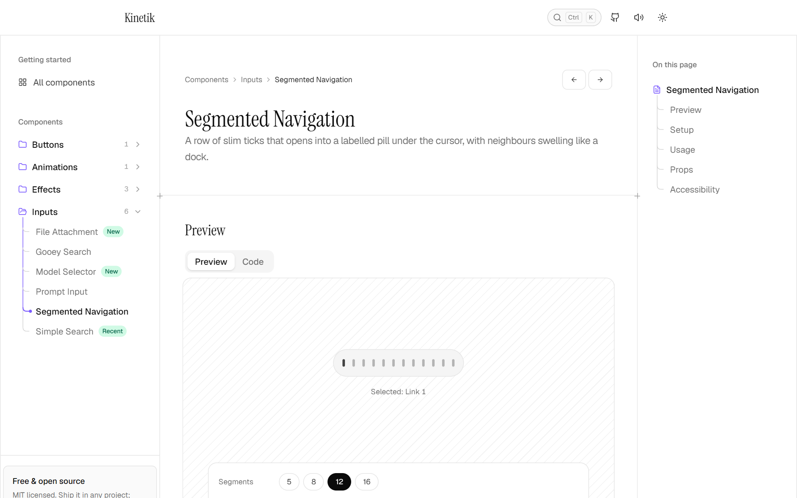

# Kinetik
Kinetik is a free, open source library of animated React components with smooth micro-interactions,
built with Tailwind CSS and Motion. Add a component with one shadcn command and the source lands in your
project: no package to keep updated, nothing hidden, and every line yours to change.

[](./LICENSE)


[](https://github.com/sponsors/GOURAVSINGH19)

Kinetik is not an npm package. Every component is source code that lands in your app, so you can
change anything and there is no package to keep updated. Install one with a single
[shadcn CLI](https://ui.shadcn.com/docs/cli) command, or copy the files by hand. Each component has a
docs page with a live preview, the full source, an install command, a setup guide and its props.

```bash
npx shadcn@latest add https://kinetikui.vercel.app/r/segmented-nav.json
```

---

## Contents

- [Components](#components)
- [Using a component](#using-a-component)
- [The shadcn registry](#the-shadcn-registry)
- [Tech stack](#tech-stack)
- [Project structure](#project-structure)
- [Running it locally](#running-it-locally)
- [Contributing](#contributing)
- [Adding a new component](#adding-a-new-component)
- [Guidelines](#guidelines)
- [Credits](#credits)
- [Support Kinetik](#support-kinetik)
- [License](#license)

---

## Preview
<table>
  <tr>
    <td width="50%">
      <picture>
        <source media="(prefers-color-scheme: dark)" srcset="apps/web/public/previews/prompt-input-dark.png">
        
      </picture>
      <p align="center"><a href="https://kinetikui.vercel.app/docs/components/prompt-input"><b>Prompt Input</b></a></p>
    </td>
    <td width="50%">
      <picture>
        <source media="(prefers-color-scheme: dark)" srcset="apps/web/public/previews/model-selector-dark.png">
        
      </picture>
      <p align="center"><a href="https://kinetikui.vercel.app/docs/components/model-selector"><b>Model Selector</b></a></p>
    </td>
  </tr>
  <tr>
    <td width="50%">
      <picture>
        <source media="(prefers-color-scheme: dark)" srcset="apps/web/public/previews/file-attachment-dark.png">
        
      </picture>
      <p align="center"><a href="https://kinetikui.vercel.app/docs/components/file-attachment"><b>File Attachment</b></a></p>
    </td>
    <td width="50%">
      <picture>
        <source media="(prefers-color-scheme: dark)" srcset="apps/web/public/previews/organic-growth-dark.png">
        
      </picture>
      <p align="center"><a href="https://kinetikui.vercel.app/docs/components/organic-growth"><b>Organic Growth</b></a></p>
    </td>
  </tr>
</table>

**The documentation site:** a live preview with controls, the full source, a one-command install and a
setup guide for every component.

<picture>
  <source media="(prefers-color-scheme: dark)" srcset=".github/assets/docs-dark.png">
  
</picture>

---

## Key features

### With the shadcn CLI (recommended)

Copy the install command from the component's docs page and run it in your project:

```bash
npx shadcn@latest add https://kinetikui.vercel.app/r/prompt-input.json
```

One command does the whole setup:

- Writes every file to the right path, keeping folder components together (`components/ui/prompt-input/`).
- Installs the npm packages, pinned to the versions Kinetik is tested with.
- Pulls in the Kinetik components it builds on. Prompt Input brings Model Selector; Segmented Navigation brings Button.
- Adds the design tokens (`--ui-*` variables and `@utility` rules) to your global CSS.
- Skips files you already have, such as `lib/utils.ts`, and asks before overwriting anything else.

Your project needs a `components.json`. If it has none, the CLI offers to create one, or run
`npx shadcn@latest init` first.

To use short names, add Kinetik once as a registry:

```bash
npx shadcn@latest registry add @kinetik=https://kinetikui.vercel.app/r/{name}.json
npx shadcn@latest add @kinetik/segmented-nav
```

### By hand

1. Open the component's page in the docs and switch the preview to **Code**. It shows the component's
   files and those of any Kinetik component it uses.
2. Install the packages listed under **Setup** (for example `npm install framer-motion lucide-react`).
3. Copy `lib/utils.ts` (the `cn()` helper) if you don't have it, and `styles/tokens.css` if the component uses design tokens.
4. Copy the component into your project, plus any component Setup says it uses:
   - **Small components** are one file, e.g. `components/ui/button.tsx`.
   - **Larger components** are a folder, e.g. `components/ui/prompt-input/`. Copy every file into it; the folder's `index.tsx` lets you import it by the folder name.

### Then use it

```tsx
import { PromptInput } from "@/components/ui/prompt-input"

export function Chat() {
  return <PromptInput onSubmit={(value) => console.log(value)} />
}
```

Requirements in your app: **React 18+** (19 recommended) and **Tailwind CSS v4**. Components work with
React Compiler turned on.

---

## The shadcn registry

The docs site doubles as a [shadcn registry](https://ui.shadcn.com/docs/registry). Every component is
served as JSON at `/r/<name>.json`, the design tokens at `/r/kinetik-tokens.json`, and a catalog of
everything at `/r/registry.json`. The files are prerendered at build time, so nothing extra needs deploying.

| File | Job |
| --- | --- |
| `apps/web/lib/component-source.ts` | Reads component sources: expands folders, rewrites imports, finds npm packages and the components each one uses |
| `apps/web/lib/registry.ts` | Turns that into registry items, the tokens item and the catalog |
| `apps/web/app/r/[name]/route.ts` | Serves `/r/<name>.json` |

The docs pages read the same module, so the Code tab, the Setup steps and what the CLI installs always
match. A new component gets a registry item automatically; there is nothing to register.

Dependency URLs are absolute and built from `PUBLIC_SITE_URL`. To test an install locally, build with it
pointing at your machine, then install into a fresh app:

```bash
cd apps/web
NODE_ENV=production PUBLIC_SITE_URL=http://localhost:3005 pnpm next build
pnpm next start -p 3005
# then, in another folder
npx create-next-app@latest test-app --yes && cd test-app
npx shadcn@latest init -d
npx shadcn@latest add http://localhost:3005/r/segmented-nav.json
```

### Troubleshooting

| Problem | Fix |
| --- | --- |
| `You need to create a components.json file` | Run `npx shadcn@latest init`, then the `add` command again. |
| The component has no colours, or classes like `bg-ui-muted` do nothing | The design tokens go into the CSS file named in `components.json` (`tailwind.css`). Make sure that file is the one your app imports, and that you're on Tailwind CSS v4. |
| A Kinetik component looks like shadcn's version | Kinetik's Button lives in `components/ui/button/`, next to shadcn's `button.tsx`. Import Kinetik's from `@/components/ui/button/button`. |
| `Module not found: @/components/ui/...` | Check that the `aliases` in `components.json` match the paths in your `tsconfig.json`. |
| `ref` errors, or a type error on `ref` | You're on React 18. Kinetik needs React 19. |
| An install command returns 404 | The name is the docs page's last URL segment, e.g. `segmented-nav` for `/docs/components/segmented-nav`. |

Still stuck? [Open an issue](https://github.com/GOURAVSINGH19/UI/issues) with the command you ran and the error.

---

## Components

Every component supports light and dark mode, works with the keyboard, and respects
`prefers-reduced-motion`. **Needs** lists the packages it installs besides React, Tailwind CSS and
`cn()` (`clsx` + `tailwind-merge`).

## Tech stack and requirements

### In your app

| Requirement | Version | Why |
| --- | --- | --- |
| [React](https://react.dev) | 19 | Components are React; some take `ref` as a regular prop |
| [Tailwind CSS](https://tailwindcss.com) | v4 | All styling, through the design tokens |
| [TypeScript](https://www.typescriptlang.org) | Recommended | Components and their props are fully typed |
| `clsx` + `tailwind-merge` | Any recent | The `cn()` helper every component uses |

Plus, only for the components that need them (see [Components](#components)):
[Motion / Framer Motion](https://motion.dev) v12, [Lucide](https://lucide.dev) icons v0.475,
[class-variance-authority](https://cva.style) and [Radix UI Slot](https://www.radix-ui.com) for Button,
[Beam](https://libraries.dev/beam) (`border-beam`) for Prompt Input, and `tw-animate-css` for Simple Search.
The shadcn CLI installs these for you, pinned to the tested versions.

### The docs site (this repo)

| Area | Tools |
| --- | --- |
| Framework | [Next.js 16](https://nextjs.org) (App Router, React Server Components, Cache Components) |
| Docs | [Fumadocs](https://fumadocs.dev) (MDX), [Shiki](https://shiki.style) for code highlighting |
| Install | A [shadcn registry](https://ui.shadcn.com/docs/registry) served at `/r/<name>.json` |
| Animation | [Motion](https://motion.dev), [GSAP](https://gsap.com), [Lenis](https://lenis.darkroom.engineering) for smooth scrolling, WebGL for the footer wordmark |
| Monorepo | [Turborepo](https://turbo.build), [pnpm](https://pnpm.io) workspaces |
| Data | Postgres ([`postgres`](https://github.com/porsager/postgres)) for the likes counter |
| Analytics | [PostHog](https://posthog.com), [Vercel Analytics](https://vercel.com/analytics) |
| Hosting / CI | [Vercel](https://vercel.com), GitHub Actions (`.github/workflows/deploy.yml`) |

---

## Contributing

Contributions of all sizes are welcome: bug fixes, docs, accessibility improvements and new components.

- **Found a bug?** [Open an issue](https://github.com/GOURAVSINGH19/UI/issues) with what you did, what
  you expected, and your browser and React version.
- **Want a component?** Open an issue describing it, ideally with a sketch, video or link to the idea.
- **Want to build one?** Open an issue first for anything bigger than a small fix, so we can agree on
  the idea before you spend time on it.

### Pull request workflow

1. **Fork** the repo and create a branch from `main`:
   ```bash
   git checkout -b feat/component-name
   ```
2. **Make your change** and check it in the browser, in both light and dark mode and at phone width.
3. **Run the checks** before pushing (CI runs `pnpm build` on every pull request):
   ```bash
   pnpm --filter web typecheck
   pnpm lint
   pnpm build
   ```
4. **Commit** with a short, clear message, e.g. `Add model selector component` or `Fix focus ring in simple search`.
5. **Open a pull request** against `main`. Describe what changed and why, and add a screenshot or short
   video for anything visual.

### Running it locally

**You need:** Node.js 20 or newer and pnpm 10 (`corepack enable` sets it up).

```bash
git clone https://github.com/GOURAVSINGH19/UI.git
cd UI
pnpm install
pnpm dev
```

Open [http://localhost:3000](http://localhost:3000).

| Command | What it does |
| --- | --- |
| `pnpm dev` | Starts the docs site with hot reload |
| `pnpm build` | Builds every app and package |
| `pnpm lint` | Lints every package |
| `pnpm format` | Formats the code with Prettier |
| `pnpm --filter web typecheck` | Type-checks the docs app and the components it uses |


### Project structure

```text
.
├── apps/
│   └── web/                         # The docs site (Next.js)
│       ├── app/                     # Routes: home, /components, /docs/[...slug], /r/[name] (registry)
│       ├── components/
│       │   ├── browser/             # Docs layout: sidebar, breadcrumbs, "on this page"
│       │   ├── docs/                # Live demos (<Name>Demo.tsx) and docs helpers
│       │   └── home/                # Home page sections
│       ├── content/docs/components/ # One MDX page per component
│       ├── lib/                     # Site config (site.ts), component index, source reader, registry
│       └── public/previews/         # Card images for the home page
├── packages/
│   ├── ui/                          # The components themselves
│   │   └── src/
│   │       ├── components/ui/       # One file or one folder per component
│   │       ├── lib/utils.ts         # cn() helper
│   │       └── styles/              # global.css and tokens.css (design tokens)
│   ├── eslint-config/               # Shared ESLint config
│   └── typescript-config/           # Shared tsconfig
├── turbo.json
└── pnpm-workspace.yaml
```

The docs app imports components from the `ui` package as `@workspace/ui/components/ui/<name>`.
A component page appears in the sidebar, the `/components` catalog and search automatically
as soon as its MDX file exists.

---

## Running it locally

**You need:** Node.js 20 or newer and pnpm 10 (`corepack enable` sets it up).

```bash
git clone https://github.com/GOURAVSINGH19/UI.git
cd UI
pnpm install
pnpm dev
```

Open [http://localhost:3000](http://localhost:3000).

| Command | What it does |
| --- | --- |
| `pnpm dev` | Starts the docs site with hot reload |
| `pnpm build` | Builds every app and package (CI runs this on every pull request) |
| `pnpm lint` | Lints every package |
| `pnpm format` | Formats the code with Prettier |
| `pnpm --filter web typecheck` | Type-checks the docs app and the components it uses |

### Environment variables (optional)

The site runs without any. Put these in `apps/web/.env.local` if you need them:

| Variable | Used for |
| --- | --- |
| `PUBLIC_SITE_URL` | The site's public URL, used for absolute links, metadata and the registry's dependency URLs (falls back to `APP_URL`, then Vercel's production URL) |
| `APP_URL` | Fallback for the site's public URL |
| `DATABASE_URL` | Postgres for the likes counter; without it, likes are kept in a local JSON file. URL-encode special characters in the password and don't wrap the value in quotes |
| `LIKES_SALT` | Salt for hashing visitor IPs in the likes counter |
| `POSTHOG_KEY` | PostHog project key (analytics are off without it) |
| `POSTHOG_HOST` | PostHog host |
| `CODE_THEME` | Shiki theme for code blocks |

---

## Contributing

Contributions of all sizes are welcome: bug fixes, docs, accessibility improvements and new components.

1. **Open an issue first** for anything bigger than a small fix, so we can agree on the idea before you build it.
2. **Fork** the repo and create a branch from `main`:
   ```bash
   git checkout -b feat/component-name
   ```
3. **Make your change** and check it in the browser, in both light and dark mode and at phone width.
4. **Run the checks** before pushing:
   ```bash
   pnpm --filter web typecheck
   pnpm build
   ```
5. **Commit** with a short, clear message, e.g. `Add model selector component` or `Fix focus ring in simple search`.
6. **Open a pull request** against `main`. Describe what changed and why, and add a screenshot or short video for anything visual.

Found a bug or have an idea? [Open an issue](https://github.com/GOURAVSINGH19/UI/issues).

---

## Adding a new component

Say you are adding a component called **Glow Card**.

**1. Write the component** in `packages/ui/src/components/ui/`.

- **Up to 200 lines:** a single file, `glow-card.tsx`.
- **Over 200 lines:** a folder, split by job, with no file over 200 lines:

  ```text
  glow-card/
  ├── glow-card.tsx   # The main component
  ├── parts.tsx       # Smaller pieces it renders
  ├── hooks.ts        # State and effects
  ├── types.ts        # Props and shared types
  └── index.tsx       # Public exports
  ```

Use `cn()` from `@workspace/ui/lib/utils` and the design tokens (`bg-ui-bg`, `text-ui-heading`,
`border-ui-border`, …) instead of hard-coded colours, so it works in both themes.

**2. Add a demo:** `apps/web/components/docs/GlowCardDemo.tsx`, a small client component that shows it off.

```tsx
"use client"

import { GlowCard } from "@workspace/ui/components/ui/glow-card/index"

export function GlowCardDemo() {
  return <GlowCard>Hello</GlowCard>
}
```

(For a single-file component the import path has no `/index`.)

**3. Add the docs page:** `apps/web/content/docs/components/glow-card.mdx`.

```mdx
---
title: Glow Card
description: One sentence on what it is and what makes it nice.
category: Effects
badge: New
---

import { GlowCardDemo } from "../../../components/docs/GlowCardDemo"
import { DocsTable } from "../../../components/docs/DocsSurface"

## Preview

<ComponentPreviewTabs
  component={<GlowCardDemo />}
  source={<ComponentCode path="components/ui/glow-card" src="../../packages/ui/src/components/ui/glow-card" tokens />}
/>

## Setup

<ComponentSetup
  path="components/ui/glow-card"
  tokens
  example={"import { GlowCard } from \"@/components/ui/glow-card\"\n\n<GlowCard>Hello</GlowCard>"}
/>

## Usage

## Props

## Accessibility
```

| Frontmatter | Meaning |
| --- | --- |
| `title` | Name shown everywhere |
| `description` | One line for cards, search and SEO |
| `category` | Sidebar group, e.g. `Buttons`, `Inputs`, `Effects`, `Animations` |
| `badge` | Optional pill such as `New` |
| `blog` | Optional link to a write-up about how it was built |

For `ComponentCode` and `ComponentSetup`, `path` is where the reader puts the code and `src`
is where it lives in this repo. Point both at the folder for a multi-file component, or at
the `.tsx` file for a single file. Add `tokens` if it uses the design tokens, and
`utils={false}` if it doesn't use `cn()`.

You don't need to list npm packages or other Kinetik components: they are read from the component's
imports, for the Setup steps, the Code tab and the registry alike. Use `dependencies` only for
packages that never appear in an import, such as the CSS-only `tw-animate-css`.

That's it: the page shows up in the sidebar, the catalog and search on its own, and the component
is installable at `/r/glow-card.json`.

**Optional:** to feature it on the home page, add its slug to `FEATURED` in
`apps/web/components/ComponentList.tsx` and add `glow-card-light.png` and `glow-card-dark.png`
(16:10) to `apps/web/public/previews/`. To change the sidebar's category order, edit
`apps/web/lib/component-groups.ts`.

### How the registry works

The docs site doubles as a [shadcn registry](https://ui.shadcn.com/docs/registry). Every component is
served as JSON at `/r/<name>.json`, the design tokens at `/r/kinetik-tokens.json`, and a catalog of
everything at `/r/registry.json`. The files are prerendered at build time, so nothing extra needs deploying.

| File | Job |
| --- | --- |
| `apps/web/lib/component-source.ts` | Reads component sources: expands folders, rewrites imports, finds npm packages and the components each one uses |
| `apps/web/lib/registry.ts` | Turns that into registry items, the tokens item and the catalog |
| `apps/web/app/r/[name]/route.ts` | Serves `/r/<name>.json` |

The docs pages read the same module, so the Code tab, the Setup steps and what the CLI installs always
match.

Dependency URLs are absolute and built from `PUBLIC_SITE_URL`. To test an install locally, build with it
pointing at your machine, then install into a fresh app:

```bash
cd apps/web
npx shadcn@latest init -d
npx shadcn@latest add http://localhost:3005/r/segmented-nav.json
```

### Coding standards

- **Accessible:** real buttons and inputs, labels on icon buttons, full keyboard support, visible focus.
- **Motion with care:** follow `prefers-reduced-motion`; animations should help, not get in the way.
- **Both themes:** use the design tokens and check light and dark mode.
- **Small files:** no file over 200 lines; split by responsibility and keep related files in one folder.
- **Few dependencies:** add a package only when it clearly earns its place.
- **Readable code:** clear names, a short comment where something isn't obvious, and code that matches its neighbours.
- **Typed:** no `any`; export the props type with the component.
- **Import other components by file:** `@workspace/ui/components/ui/button/button`, not `button/index`. The shadcn CLI drops `/index`, which can point the import at a user's own `button.tsx` instead.
- **React Compiler safe:** call every hook as its own statement, never inside an object literal, an array or a condition.

---

## Support Kinetik

Every component is free and stays free. If Kinetik saves you time, you can
[sponsor its development on GitHub](https://github.com/sponsors/GOURAVSINGH19). It funds new components and keeps
the existing ones maintained. Starring the repo and sharing a component you like helps too.

## License and links

[MIT](./LICENSE) © 2026 [Gourav Singh](https://github.com/GOURAVSINGH19). Use Kinetik in personal and
commercial projects. Credit is appreciated but not required.

| | |
| --- | --- |
| Documentation | [kinetikui.vercel.app](https://kinetikui.vercel.app) |
| All components | [kinetikui.vercel.app/components](https://kinetikui.vercel.app/components) |
| Issues | [Report a bug or request a component](https://github.com/GOURAVSINGH19/UI/issues) |
| Maintainer | Gourav Singh · [X](https://x.com/GouravSing85027) · [LinkedIn](https://www.linkedin.com/in/gourav-singh-814293258) · [GitHub](https://github.com/GOURAVSINGH19) |

