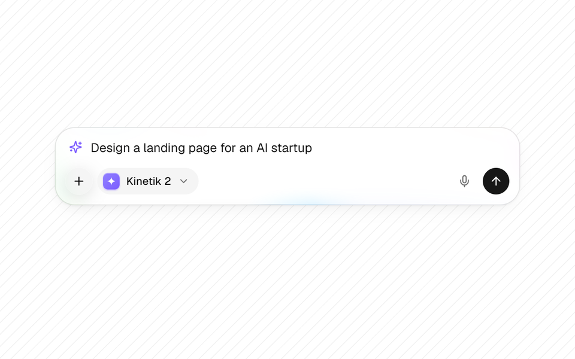
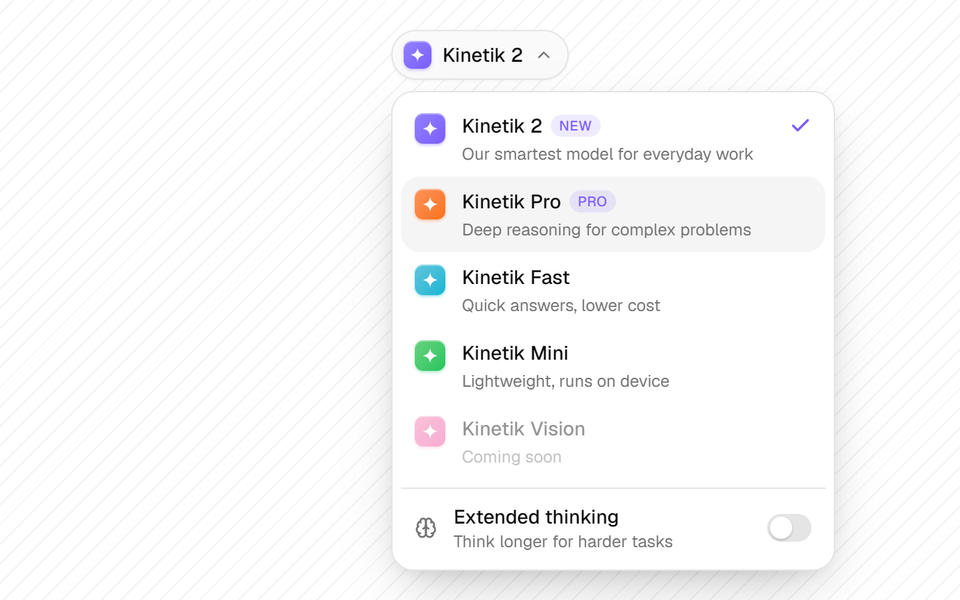
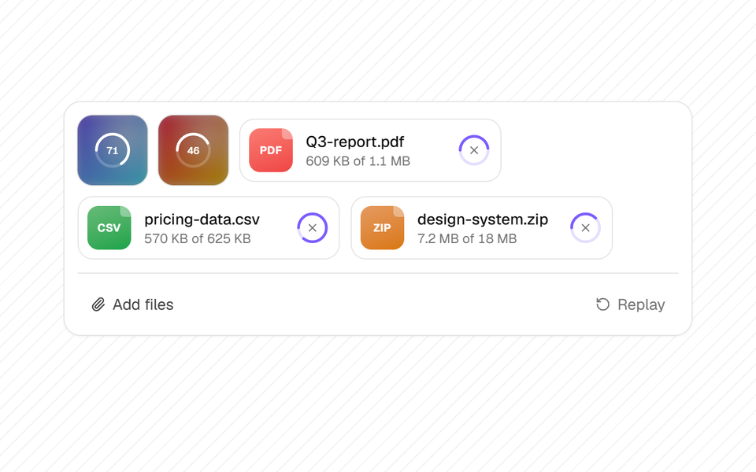
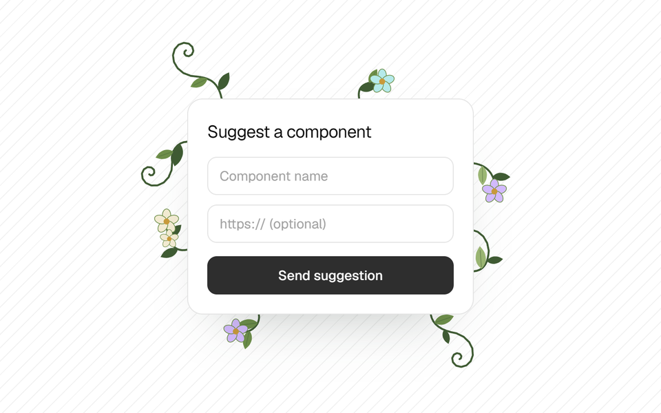
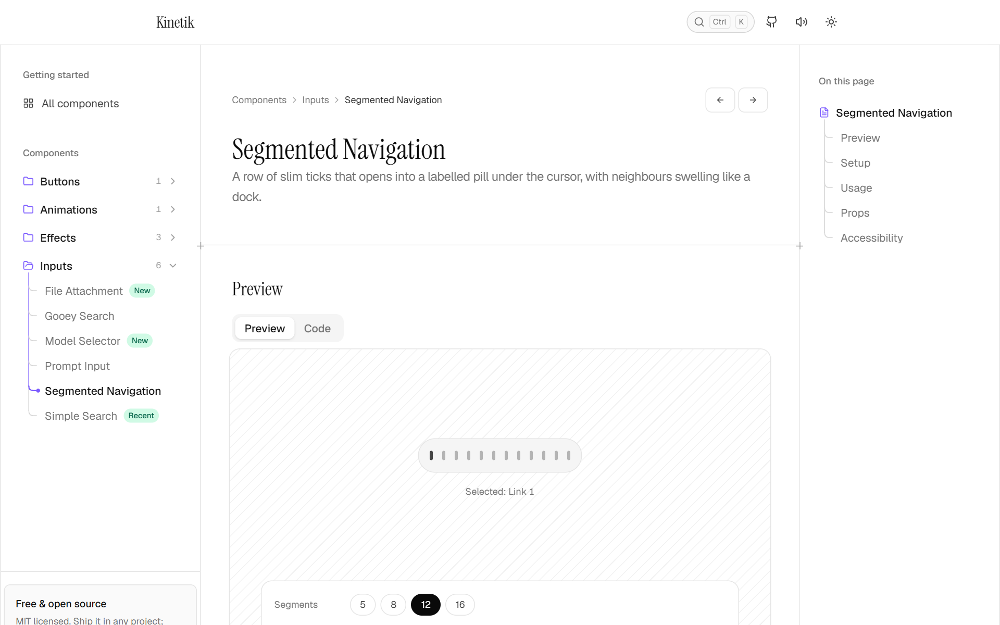

<div align="center">

# Kinetik

**Free, open source React components with smooth micro-interactions.**<br>
Built with Tailwind CSS and Motion. Copy the code into your project and make it yours.

[](./LICENSE)


[](https://github.com/sponsors/GOURAVSINGH19)

[**Docs**](https://kinetikui.vercel.app) &nbsp;·&nbsp;
[**Components**](#-components) &nbsp;·&nbsp;
[**Preview**](#-preview) &nbsp;·&nbsp;
[**Install**](#-install) &nbsp;·&nbsp;
[**Requirements**](#-requirements) &nbsp;·&nbsp;
[**Contributing**](#-contributing) &nbsp;·&nbsp;
[**License**](#-license)

</div>

---

Kinetik is not an npm package. Every component is source code that lands in your app, so you can change
anything and there is no package to keep updated. Install one with a single
[shadcn CLI](https://ui.shadcn.com/docs/cli) command, or copy the files by hand.

```bash
npx shadcn@latest add https://kinetikui.vercel.app/r/segmented-nav.json
```

> [!NOTE]
> This repo is the **free** edition. A few larger components are part of **Kinetik Pro**, listed
> [below](#kinetik-pro).

### Kinetik Pro

Not in this repo. Live previews are on the [docs site](https://kinetikui.vercel.app); the source comes
with Kinetik Pro.

| Component | What it is |
| --- | --- |
| Column Layout | Switch between a tilted 3D stack and a sideways row, with cards easing into place |
| Koi Pond | A tiny living koi pond in WebGL with a dithered pixel finish |
| Particle Dissolve | Break any element into drifting dust when it is deleted or dismissed |
| Particle Orb | A GPU-simulated sphere of glowing dust that scatters under the cursor |

---

## 👀 Preview

<table>
  <tr>
    <td width="50%">
      <picture>
        <source media="(prefers-color-scheme: dark)" srcset="public/previews/prompt-input-dark.png">
        
      </picture>
      <p align="center"><a href="https://kinetikui.vercel.app/docs/components/prompt-input"><b>Prompt Input</b></a></p>
    </td>
    <td width="50%">
      <picture>
        <source media="(prefers-color-scheme: dark)" srcset="public/previews/model-selector-dark.png">
        
      </picture>
      <p align="center"><a href="https://kinetikui.vercel.app/docs/components/model-selector"><b>Model Selector</b></a></p>
    </td>
  </tr>
  <tr>
    <td width="50%">
      <picture>
        <source media="(prefers-color-scheme: dark)" srcset="public/previews/file-attachment-dark.png">
        
      </picture>
      <p align="center"><a href="https://kinetikui.vercel.app/docs/components/file-attachment"><b>File Attachment</b></a></p>
    </td>
    <td width="50%">
      <picture>
        <source media="(prefers-color-scheme: dark)" srcset="public/previews/organic-growth-dark.png">
        
      </picture>
      <p align="center"><a href="https://kinetikui.vercel.app/docs/components/organic-growth"><b>Organic Growth</b></a></p>
    </td>
  </tr>
</table>

<details>
<summary><b>The docs site</b></summary>
<br>

<picture>
  <source media="(prefers-color-scheme: dark)" srcset=".github/assets/docs-dark.png">
  
</picture>

</details>

---

## 📦 Install

<details open>
<summary><b>With the shadcn CLI</b> &nbsp;<sub>recommended</sub></summary>
<br>

Copy the install command from the component's docs page and run it in your project:

```bash
npx shadcn@latest add https://kinetikui.vercel.app/r/sliding-tabs.json
```

It writes the files to the right path, installs the npm packages, pulls in the Kinetik components it builds
on, and adds the design tokens to your global CSS. Your project needs a `components.json`; if it has none,
run `npx shadcn@latest init` first.

To use short names, add Kinetik once as a registry:

```bash
npx shadcn@latest registry add @kinetik=https://kinetikui.vercel.app/r/{name}.json
npx shadcn@latest add @kinetik/segmented-nav
```

</details>

<details>
<summary><b>By hand</b></summary>
<br>

1. Install the packages the component needs (for example `npm install framer-motion lucide-react`).
2. Copy `lib/utils.ts` (the `cn()` helper) if you don't have it, and `styles/tokens.css` if the component
   uses design tokens.
3. Copy the component into your project:
   - **Small components** are one file, e.g. `components/segmented-nav.tsx`.
   - **Larger components** are a folder, e.g. `components/menubar/`. Copy every file in it; the folder's
     `index.tsx` lets you import it by the folder name.
4. Check the imports. Components import from `@/lib/utils` and `@/components/...`, so your project needs
   the `@/` path alias (most Next.js and Vite setups have it).

```tsx
import { SegmentedNav } from "@/components/segmented-nav"
```

</details>

---

## ⚙️ Requirements

| Requirement | Version | Why |
| --- | --- | --- |
| [React](https://react.dev) | 19 | Some components take `ref` as a regular prop |
| [Tailwind CSS](https://tailwindcss.com) | v4 | All styling, through the design tokens |
| [TypeScript](https://www.typescriptlang.org) | Recommended | Components and props are fully typed |
| `clsx` + `tailwind-merge` | Any recent | The `cn()` helper every component uses |

Some components also use [Motion](https://motion.dev) (`framer-motion` v12), [Lucide](https://lucide.dev)
icons, [Hugeicons](https://hugeicons.com), Radix UI primitives and [border-beam](https://www.npmjs.com/package/border-beam).
The shadcn CLI installs these for you.

---

## 🤝 Contributing

Bug reports, fixes and ideas are all welcome.

- **Found a bug?** [Open an issue](https://github.com/GOURAVSINGH19/kinetik-free/issues/new) with what you
  expected, what happened and how to reproduce it.
- **Want to fix something?** Read [CONTRIBUTING.md](./CONTRIBUTING.md) for how to set up, the code
  conventions and how to send a pull request.
- **Have an idea for a component?** Open an issue first so we can talk it through before you build it.

---

## 📄 License

[MIT](./LICENSE) for everything in this repo. Kinetik Pro components are licensed separately.
